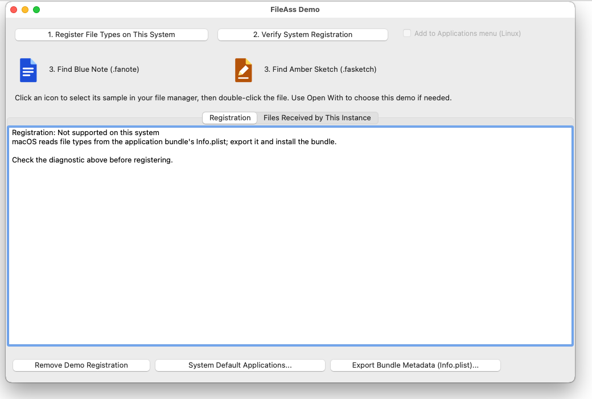

# FileAss

### File associations and single-instance apps. Drop, configure, done.

Two nonvisual components for **Free Pascal / Lazarus** that take care of
operating-system file associations and keeping one copy of your app running.
Most setup happens in the **Object Inspector**, with the same application
code on **Windows and Linux**.

### 📄 Give your files an application

Drop **`TFileAssMan`** on a form, set your application name and ID, then add
extensions and document icons to its **FileTypes** collection. Register or
remove them with one call from your application's install action:

```pascal
FileAssMan1.RegisterAll;
// When removing the associations:
FileAssMan1.UnregisterAll;
```

Registration is explicit and preserves the user's chosen default apps.
[Configuration and registration →](GUIDE.md#configure-in-the-object-inspector)

### ⭐ One application instance, without writing IPC code

Drop **`TFileAssInstance`** on your main form, set its **ApplicationID**
(or link it to `TFileAssMan`), and set **Enabled = True**. That's the component
setup for single-instance enforcement—no event handler required.

Want files opened in the existing window? Select **fimForwardParameters**
and assign **OnParameters**. The component queues requests during startup
and delivers them when your application is ready.
[Forwarding, readiness, and events →](GUIDE.md#single-instance-applications)

### Try it in Lazarus

[Install the package →](GUIDE.md#install-in-lazarus), then open
**[demo/FileAssDemo.lpi](demo/FileAssDemo.lpi)**. Register the sample types,
click a document icon to find its file, and open more files into the same
running instance. The demo includes a real `.lfm` with the component settings.

 

### 🛠️ More when you need it

[Installer exports](GUIDE.md#export-association-files-for-an-installer),
[application-menu launchers and icons](GUIDE.md#application-launchers-and-icons),
and [console applications](GUIDE.md#console-applications) use the same core.
The [developer guide](GUIDE.md) covers setup, properties, and platform details.
Property explanations are also available right in the Object Inspector.

### ✅ What it has been tested on

| | Linux | Windows | macOS |
|---|---|---|---|
| Tested on | Mint, Cinnamon desktop | Windows 10, and Wine | Sequoia 15, Intel, in a virtual machine |
| Built with | Lazarus trunk, FPC 3.3.1 | the same, cross-compiled | Lazarus 4.8, FPC 3.2.4 |
| Core unit tests | ✅ | ✅ | ✅ |
| Register and remove file types | ✅ | ✅ | not how a Mac does it - see the next row |
| Installer export | ✅ `.desktop`, MIME, icons | ✅ `.reg` | ✅ `Info.plist`, accepted by Apple's `plutil` |
| Document icons show in the file manager | ✅ | ✅ | not checked yet |
| One instance: unit tests | ✅ | ✅ | ✅ |
| Fifty copies started at once pick one primary and lose nothing | ✅ | ✅ | ✅ |
| Launches queued while the first copy is still starting | ✅ | ✅ | ✅ |
| A killed primary lets go, and its queue survives | ✅ | ✅ | ✅ |
| A document opened by the system arrives in the running copy | ✅ | ✅ | ✅ |
| The demo, clicked through by hand | ✅ | ✅ | not yet |

Still wanted: the demo clicked through in Finder on a real Mac (and how the
document icons look there), Apple Silicon, Windows 11, and file managers
other than Cinnamon's. If you can try one,
[say how it went](../../issues).



**[0BSD licensed](LICENSE)** · Free to use in your applications.

Copyright (c) 2026 Tony Stone.
